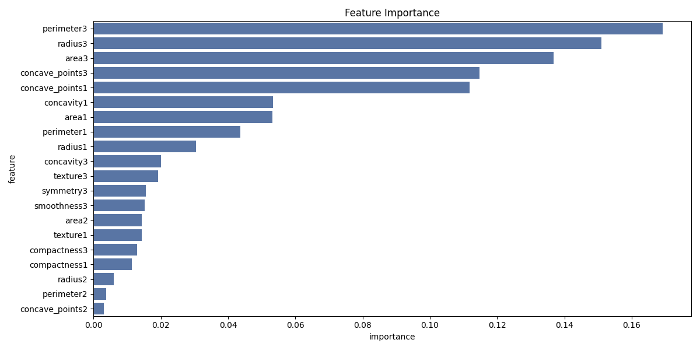
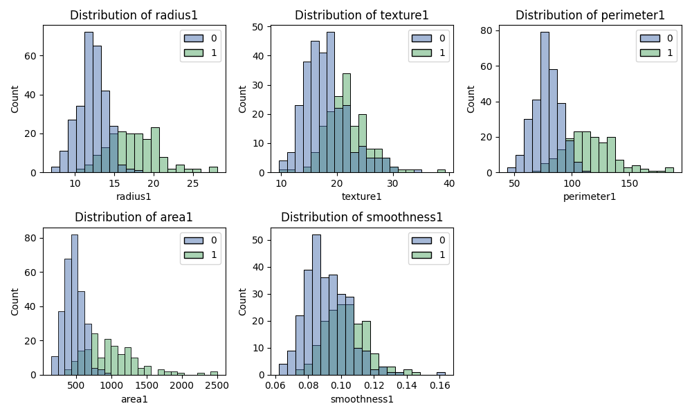
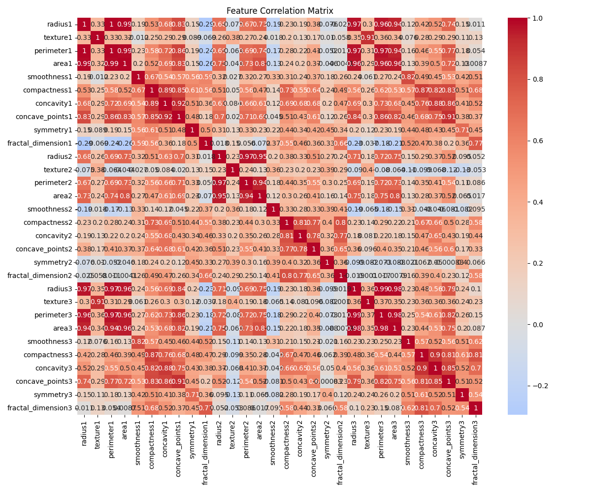

## Context

This project builds an end-to-end ML pipeline for breast cancer detection, classifying tumors as benign or malignant from a set of diagnostic features.

## Approach

The pipeline uses statistical testing, outlier detection, feature selection, and model optimization. The model takes its features in the following order:

```text
['radius1', 'texture1', 'perimeter1', 'area1', 'smoothness1', 'compactness1', 'concavity1', 'concave_points1', 'symmetry1', 'fractal_dimension1', 'radius2', 'texture2', 'perimeter2', 'area2', 'smoothness2', 'compactness2', 'concavity2', 'concave_points2', 'symmetry2', 'fractal_dimension2', 'radius3', 'texture3', 'perimeter3', 'area3', 'smoothness3', 'compactness3', 'concavity3', 'concave_points3', 'symmetry3', 'fractal_dimension3', 'Diagnosis']
```

## Impact

The model reached 95.6% accuracy with perfect precision.






